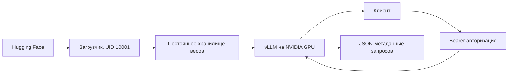

# Архитектура

## Загрузка и целостность

`MODEL_ID` и полный SHA коммита задают неизменяемую ревизию модели. Загрузчик берёт файловую блокировку, скачивает данные во временный каталог и публикует готовый снимок атомарным переименованием. Манифест фиксирует размер и SHA-256 каждого файла. Для разбитых весов проверяются все части из `model.safetensors.index.json`.

Готовый снимок проверяется до импорта Hugging Face Hub. Повторный запуск загрузчика может пройти с отключённой сетью и недоступной библиотекой Hub. Сервер получает веса только для чтения и работает с `HF_HUB_OFFLINE=1`.

## GPU и WSL

Основной профиль использует BF16, контекст до 4096 токенов и до четырёх одновременно обрабатываемых последовательностей. `gpu_memory_utilization=0.65` ограничивает бюджет памяти vLLM; часть бюджета занимает KV-кэш. Это не размер одних весов модели.

В выбранной версии vLLM используется `VLLM_USE_V2_MODEL_RUNNER=0`: V2 требует UVA, недоступный в проверенном WSL-окружении. Совместимый V1 продолжает выполнять вычисления на GPU. [Обсуждение в vLLM](https://github.com/vllm-project/vllm/issues/50239).

Triton компилирует и загружает ядра во время работы. Поэтому `/tmp` у сервера доступен для записи и исполнения, а корневая файловая система остаётся только для чтения.

В Minikube на WSL требуется мост `libdxcore.so`. `configure_wsl_gpu.py` настраивает NVIDIA CDI внутри выделенного узла и подключает библиотеку к системному device plugin. Изменения ограничены узлом `llm-inference-lab-gpu`; приложению не нужны привилегированный режим и hostPath-тома. [Диагностика аналогичной проблемы NVIDIA](https://github.com/NVIDIA/OpenShell/issues/404).

## Авторизация и логи

Compose передаёт токен через файл Secret, Kubernetes использует Secret с ключом `api-token`. Токен не попадает в аргументы команд. Перед запуском vLLM приложение загружает его в окружение процесса; HF-токен серверу не передаётся.

ASGI middleware проверяет авторизацию до обработки API-запроса. `/health` и `/metrics` доступны для внутренних проверок. Compose публикует порт только на `127.0.0.1`, Kubernetes использует ClusterIP.

Аудит сохраняет собственный request ID, разрешённое имя маршрута, метод, HTTP-статус и длительность. Тела запросов, ответы, заголовки и строки query не записываются. Форматтер не сериализует сообщения сторонних библиотек и тексты исключений. Стандартная печать traceback также заменена безопасным событием.

## Воспроизводимость

GPU-образ закреплён OCI digest. `requirements.txt` содержит версии 263 активных Python-дистрибутивов из этого образа; сборка проверяет соответствие полного списка. Системные библиотеки и неактивные дубли пакетов также закреплены digest базового образа. Загрузчик устанавливает зависимости из отдельного файла с хешами.

`config/runtime.json` фиксирует выбранный образ. `scripts/freeze_runtime.py` обновляет инвентаризацию зависимостей после осознанной смены базового образа. Ревизия модели закреплена независимо от образа.
